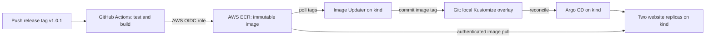

# Local GitOps Interview Demo

A small, real CI/CD loop: GitHub Actions builds a website, AWS ECR stores immutable multi-platform images, and Argo CD deploys them to kind on an Apple Silicon Mac.

## Overall flowchat


For production, prefer promotion pull requests and immutable digests, protected environments, externally managed credentials, image signing and vulnerability gates. Automatic deployment of eligible versioned releases is intentional for this **development demo**, not a production approval policy.

## Layout

| Path | Purpose |
| --- | --- |
| `app/` | Dependency-free Node.js website, HTTP tests, Dockerfile |
| `.github/workflows/ci.yaml` | Test and publish only on `v*` Git tag pushes through OIDC |
| `infra/kind/` | Single-node local cluster |
| `infra/argocd/` | Pinned Argo CD installation |
| `infra/image-updater/` | Pinned Image Updater v1 installation and polling configuration |
| `infra/aws/` | Example OIDC trust and repository-scoped IAM policies |
| `gitops/apps/demo-web/` | Application base and local image overlay |
| `gitops/argocd/` | Restricted project, Application, and ImageUpdater CR |
| `scripts/` | Explicitly context-scoped cluster setup and ECR token refresh |

## Tag Policy

Push a stable Git release tag to publish one human-readable image tag:

```text
Git tag:   v1.0.1
Image tag: 1.0.1
```

- ECR must enforce **IMMUTABLE** tags. Never deploy a mutable `latest` tag.
- Only stable MAJOR.MINOR.PATCH versions without leading zeros are accepted. CI verifies the tagged commit belongs to main history before obtaining AWS credentials.
- Only `v*` tag pushes start the workflow. Branch pushes, PRs, and merges do not run CI; manual dispatch is disabled. Run `npm --prefix app test` locally before merging. Do not require this tag-only workflow as a PR status check.
- Image Updater uses semantic-version ordering, so `1.10.0` is newer than `1.9.0`. Old `main-*`, hash, and prerelease tags are ignored.
- A version can be published only once. CI rejects an existing version; after a partial publish, inspect ECR and use a new version rather than deleting or moving release tags. Never rebuild a published version.
- The build embeds its tag, full source SHA, and build time in `/version` and on the page. CI records the manifest digest too.
- Protect `v*` Git tags with repository rulesets restricting creation, update, and deletion. The AWS trust allows this exact repository's `v*` tag refs, not main-branch refs. Main ancestry is a workflow check, not an IAM-enforced condition.
- The highest eligible tag wins. Intermediate builds can be skipped between polls; this is convergence, not a deployment queue.

## 1. Prerequisites

Install and start Docker Desktop (or another kind-compatible Docker runtime). Suggested Docker VM allocation: 4 CPUs and 8 GB RAM; the application is tiny, but Argo CD has several components.

```bash
brew install kind kubectl awscli node
docker info
kind version
kubectl version --client
node --version
```

Use Node.js 22 or newer and a supported kind version. The bootstrap pins `kindest/node:v1.32.2`; use kubectl within one minor version of the cluster. Both image architectures are built in CI because GitHub's default hosted runner is AMD64 and a Mac Studio is ARM64.

The manifests pin Argo CD `v3.2.0`, Image Updater `v1.0.0`, and Node `22.22.0-alpine` as explicit scaffold baselines. These are **not a claim that those are the latest or security-approved versions**. Review release notes/security advisories and update compatible pins before use beyond this demo. In particular, do not mix the v1.0.0 CR schema with examples from newer Image Updater documentation without checking compatibility.

## 2. Configure This Repository

Create an empty GitHub repository, preferably named `demo-k8s`, with `main` as its default branch. This scaffold assumes GitHub Actions and an existing **private ECR repository in the same AWS account as the CI role**; adapt the policies if using cross-account access.

```bash
cp .env.example .env
```

Edit `.env` with your AWS region, account ID, and existing ECR repository name. This file is sourced as shell code by the helpers, so keep it trusted. Keep credentials out of it; use an AWS CLI profile/SSO session.

Replace the example values in the committed configuration:

| Example | Replace in |
| --- | --- |
| `YOUR_OWNER/demo-k8s` | Both `gitops/argocd/project.yaml` and `application.yaml`; OIDC trust JSON |
| `111122223333`, `us-east-1`, `demo-web` ECR repository | All three AWS JSON files; image URI in local overlay and ImageUpdater CR |
| `bootstrap` | Local overlay `newTag`, after the first successful CI run |

The Kubernetes application name remains `demo-web`; only change the ECR repository component of image URIs if your ECR repository has a different name. The `.env` values do **not** substitute into YAML automatically.

## 3. Prepare AWS and GitHub CI

An AWS administrator performs the following setup. Nothing in this scaffold creates an ECR repository, IAM role, or OIDC provider automatically.

1. Reuse/create the IAM OIDC provider `https://token.actions.githubusercontent.com` with audience `sts.amazonaws.com`.
2. Create role `demo-k8s-github-ci` with the edited trust document `infra/aws/github-oidc-trust.json`. Its subject is restricted to this repository's `v*` tag refs, not all GitHub repositories or PRs. The subject includes owner/repository IDs observed in CloudTrail; do not replace it with a name-only subject without checking your actual OIDC claims.
3. Attach the edited `infra/aws/ecr-push-policy.json` as an inline policy. `GetAuthorizationToken` requires `Resource: "*"`; push operations are scoped to one repository.
4. Configure the existing ECR repository for immutable tags and enable image scanning. Scanning alone does not block this pipeline; a production gate must inspect its findings explicitly.
5. Grant your local AWS CLI identity the edited read policy in `infra/aws/ecr-read-policy.json`. It obtains the short-lived ECR credentials used by Image Updater and kubelet. Keep this identity separate from the CI publishing role.

Example IAM commands **after replacing the JSON placeholders**, for an administrator with IAM permissions:

```bash
aws iam create-role --role-name demo-k8s-github-ci \
  --assume-role-policy-document file://infra/aws/github-oidc-trust.json
aws iam put-role-policy --role-name demo-k8s-github-ci \
  --policy-name EcrPush --policy-document file://infra/aws/ecr-push-policy.json
```

For an existing role, review/update its trust instead of running `create-role` again. Confirm the OIDC provider exists before creating the role.

Set these GitHub repository **Actions variables**, not AWS access-key secrets:

| Variable | Example |
| --- | --- |
| `AWS_ROLE_ARN` | `arn:aws:iam::111122223333:role/demo-k8s-github-ci` |
| `AWS_REGION` | `us-east-1` |
| `ECR_REPOSITORY` | `demo-web` |

Commit and push the scaffold to `main` using your normal Git setup. Main pushes do not start CI; release tags run tests, build `linux/amd64` and `linux/arm64`, attach provenance/SBOM, and publish an image. Do not initialize a second repository if this directory is already inside one. For a completely new repository:

```bash
git init -b main
git add .
git commit -m "Scaffold local GitOps demo"
git remote add origin git@github.com:YOUR_OWNER/demo-k8s.git
git push -u origin main
```

After the updated workflow is on main, create the first release:

```bash
git tag v1.0.1
git push origin v1.0.1
```

Wait for the successful release build. Set the local overlay's `newTag` to `1.0.1`, commit, and push. This prevents a first deployment from pulling the intentionally nonexistent `bootstrap` image. GitOps-only commits do not trigger another image build. Manual workflow dispatch is disabled. For later releases, increment the version, for example `v1.0.2`.

## 4. Bootstrap kind and Argo CD

```bash
bash scripts/bootstrap.sh
kubectl --context kind-interview-demo -n argocd get pods
```

The helper reuses a cluster named `interview-demo` if present; delete/recreate it intentionally if its configuration is stale. All helper kubectl calls specify `kind-interview-demo`, irrespective of your current context. Server-side apply with force-conflicts is limited to this dedicated demo cluster. The cluster is local and single-node, not highly available. Two replicas demonstrate rolling updates, not node resilience.

## 5. Give Argo CD and Image Updater Git Access

Create a dedicated, passwordless SSH deploy key **outside this repository**. The private key becomes a Kubernetes Secret, so this is a demo credential, not an encrypted-at-rest secret-management solution. Do not reuse your personal SSH key or commit the key.

```bash
ssh-keygen -t ed25519 -C demo-k8s-gitops -N '' -f "$HOME/.ssh/demo-k8s-gitops"
```

Add the **public** key to this repository's GitHub Deploy keys and enable **Allow write access**. Do not overwrite an existing key at that path. The default Argo CD SSH known-hosts ConfigMap supplies GitHub host verification; verify it against GitHub's published fingerprints rather than disabling verification if SSH fails.

Create one repository secret for Argo CD reads and an explicit write-back secret for Image Updater:

```bash
kubectl --context kind-interview-demo -n argocd create secret generic demo-repository \
  --from-literal=type=git \
  --from-literal=url=git@github.com:YOUR_OWNER/demo-k8s.git \
  --from-file=sshPrivateKey="$HOME/.ssh/demo-k8s-gitops" \
  --dry-run=client -o yaml | kubectl --context kind-interview-demo apply -f -
kubectl --context kind-interview-demo -n argocd label secret demo-repository \
  argocd.argoproj.io/secret-type=repository --overwrite
kubectl --context kind-interview-demo -n argocd create secret generic git-write-back \
  --from-file=sshPrivateKey="$HOME/.ssh/demo-k8s-gitops" \
  --dry-run=client -o yaml | kubectl --context kind-interview-demo apply -f -
```

Branch protection that requires PRs will reject direct updater commits. For this isolated demo, permit this deploy key to push to `main`, or use a separate writable GitOps branch and update both the Application and updater branch. In production, use a bot/GitHub App and a supported PR-based promotion workflow; do not weaken a shared production branch's rules for the demo.

## 6. Authenticate to ECR and Deploy

Use a local AWS CLI SSO/profile session with the read policy, then refresh **both** namespace-scoped secrets:

```bash
export AWS_PROFILE=your-demo-profile
aws sso login --profile "$AWS_PROFILE"
bash scripts/refresh-ecr-secrets.sh
kubectl --context kind-interview-demo apply -f gitops/argocd/project.yaml
kubectl --context kind-interview-demo apply -f gitops/argocd/application.yaml
kubectl --context kind-interview-demo apply -f gitops/argocd/image-updater.yaml
kubectl --context kind-interview-demo -n demo get pods -w
```

For a non-SSO profile, authenticate using your organization's usual AWS CLI procedure instead. Stop the watch with Ctrl+C once pods are ready, then:

```bash
kubectl --context kind-interview-demo -n demo rollout status deployment/demo-web --timeout=300s
```

ECR passwords expire after **12 hours** and may become unusable sooner if the originating AWS session expires. Re-run the refresh helper before each interview and periodically for longer sessions. It stores only an ECR Docker token in each namespace, not AWS keys, and uses a restricted temporary file instead of putting the token on the command line. Image Updater reads its per-image secret on each poll, so no controller restart is needed after token refresh.

This is deliberately **not unattended credential rotation**. In a long-running installation, use a secret controller/credential provider with renewable identity and ensure both registry discovery and kubelet pulls renew their credentials. A local kind cluster has no EKS IRSA/Pod Identity automatically.

## 7. Open the Demo

The website is available at `http://127.0.0.1:8080` without a port-forward. kind maps localhost port 8080 to node port 30080. The Application's `spec.source.kustomize.patches` configures the website Service as NodePort 30080; Argo CD applies it and Kubernetes routes traffic to ready pods as they are replaced. This bootstrap-level patch keeps the shared Service base unchanged.

Existing clusters must be recreated to add or change kind host-port mappings. Editing the configuration does not update an existing node container. Recreating the cluster removes its workloads, secrets, and Argo CD history; restore access credentials before reapplying the Application. Do not start a website port-forward on port 8080, which is now reserved by kind.

Only the Argo CD admin UI needs a port-forward. Keep it in its own terminal and do not expose it publicly:

```bash
kubectl --context kind-interview-demo -n argocd port-forward svc/argocd-server 8443:443
```

Open `https://localhost:8443`. The default local certificate is self-signed. Sign in as `admin` using the initial password printed **locally** by this command, then change it after the demo:

```bash
kubectl --context kind-interview-demo -n argocd get secret argocd-initial-admin-secret \
  -o jsonpath='{.data.password}' | base64 --decode; printf '\n'
```

Open the website at `http://127.0.0.1:8080`. Unlike a pod-bound port-forward, the host mapping remains available during application rollouts while ready endpoints exist. The local cluster and Docker runtime must still be running.

## 8. Interview Walkthrough

1. Show the green Argo CD Application and the website's image tag and source commit.
2. Edit the headline in `app/public/index.html`, commit, push to `main`, and push a new release tag such as `v1.0.2` pointing to that commit.
3. Show Actions tests, AWS OIDC authentication, multi-platform build, immutable tag, and image digest.
4. Show the new tag in ECR. Image Updater polls roughly every minute; Argo CD Git refresh can add roughly another three minutes, plus build/image-pull time.
5. Show the updater commit changing `gitops/apps/demo-web/overlays/local/kustomization.yaml`, then Argo CD's sync and the rolling update. No application deployment command is run by CI.
6. Refresh the website to show the new headline, tag, and source SHA. The source SHA identifies the application build, not the later bot deployment commit.
7. Optionally demonstrate drift correction: scale the deployment to one replica with kubectl and observe Argo CD restore two through self-heal.

Useful observability:

```bash
kubectl --context kind-interview-demo -n argocd get application demo-web
kubectl --context kind-interview-demo -n argocd get imageupdater demo-web -o yaml
kubectl --context kind-interview-demo -n argocd logs deployment/argocd-image-updater-controller --tail=80
kubectl --context kind-interview-demo -n demo get pods -w
```

For rollback, **pause the updater first**, then revert the relevant bot image commit in Git and push. Auto-sync will otherwise redeploy the highest eligible tag and undo your rollback. Do not rely on `kubectl rollout undo` under self-heal.

```bash
kubectl --context kind-interview-demo -n argocd delete imageupdater demo-web
git pull --rebase origin main
git log --oneline -- gitops/apps/demo-web/overlays/local/kustomization.yaml
git revert <image-update-commit>
git push origin main
```

Allow any in-flight reconciliation to settle before the revert and confirm no newer bot commit raced it. Before reapplying the ImageUpdater CR, add the bad tag(s) to that image's `commonUpdateSettings.ignoreTags` and commit the exclusion, or publish a fix. Resuming without an exclusion/fix intentionally selects the bad highest tag again. The ImageUpdater CR is manually bootstrapped here; editing its YAML also requires reapplying it.

## Local Development and Checks

```bash
npm --prefix app test
PORT=8090 npm --prefix app start
```

The development server runs at `http://localhost:8090`; the deployed website uses port 8080 through kind. To check the deployment without a cluster:

```bash
kubectl kustomize gitops/apps/demo-web/overlays/local
kubectl kustomize infra/image-updater
kubectl kustomize infra/argocd
bash -n scripts/common.sh scripts/bootstrap.sh scripts/refresh-ecr-secrets.sh
```

The remote controller manifests require internet access. Resolve/pin image digests and vendor these manifests for a fully repeatable offline demo. Keep representative screenshots and a recorded successful run available for interview network failures.

## Troubleshooting and Cleanup

| Symptom | Check |
| --- | --- |
| CI cannot assume role | OIDC provider, ID-qualified repository/release-tag subject, ARN variable, `id-token: write` |
| CI cannot push | Repository exists in selected region/account; scoped push policy; version not already published |
| `ImagePullBackOff` | `demo/ecr-pull` is fresh; image URI/tag exists; manifest includes ARM64 |
| Updater gets 401 | `argocd/ecr-pull` is fresh and the local identity can read this ECR repository |
| Updater never chooses tag | Stable semantic version, correct repository, updater logs; old `main-*` tags are ignored |
| Git write-back fails | Write-enabled deploy key, correct SSH repo URL, main branch protection, verified known-hosts |
| Argo CD is OutOfSync | Git access, correct path/branch, controller logs, Application conditions |
| Website still looks old | `/version`, current pod image, Git sync status, browser refresh |
| Website cannot connect | Docker/kind running, node mapping 8080 to 30080, Service NodePort 30080, ready endpoints; no website port-forward needed |

```bash
kind delete cluster --name interview-demo
```

This deletes the local cluster only. Stop port-forwards, revoke/remove the demo deploy key, and remove temporary IAM access when finished. ECR storage and transfer may incur small charges; deleting kind does not remove ECR images, IAM roles, or GitHub resources. Retain any deployed/rollback image tags when defining an ECR lifecycle policy.
